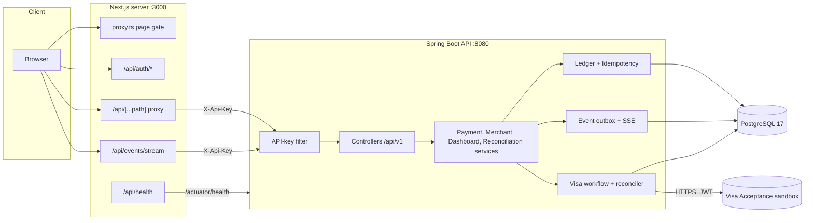
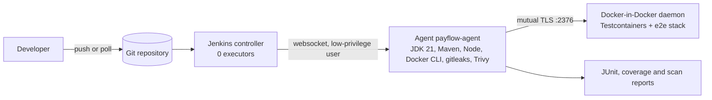
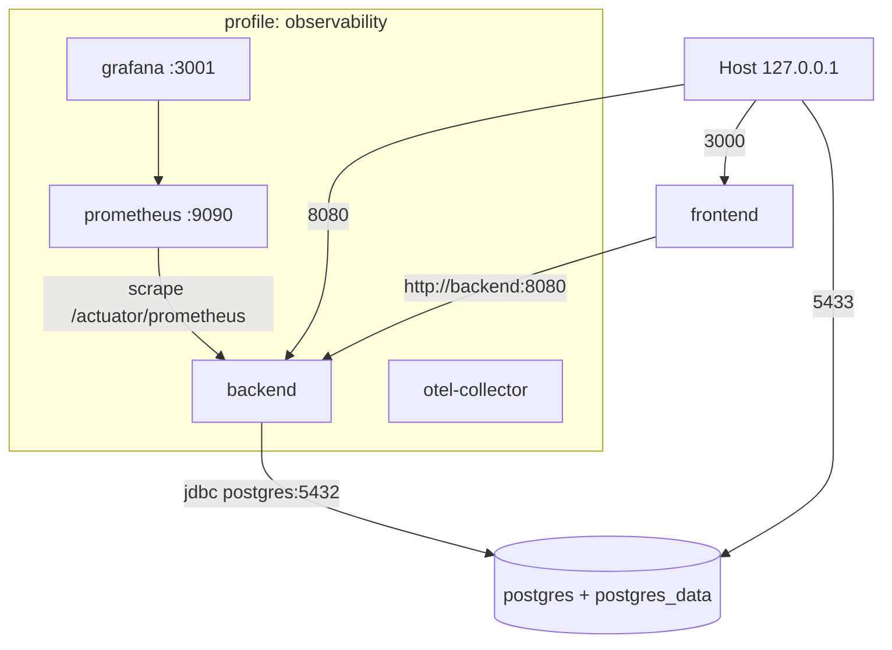
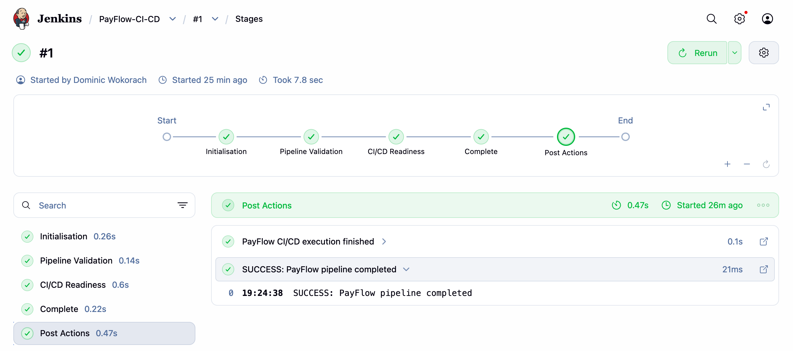
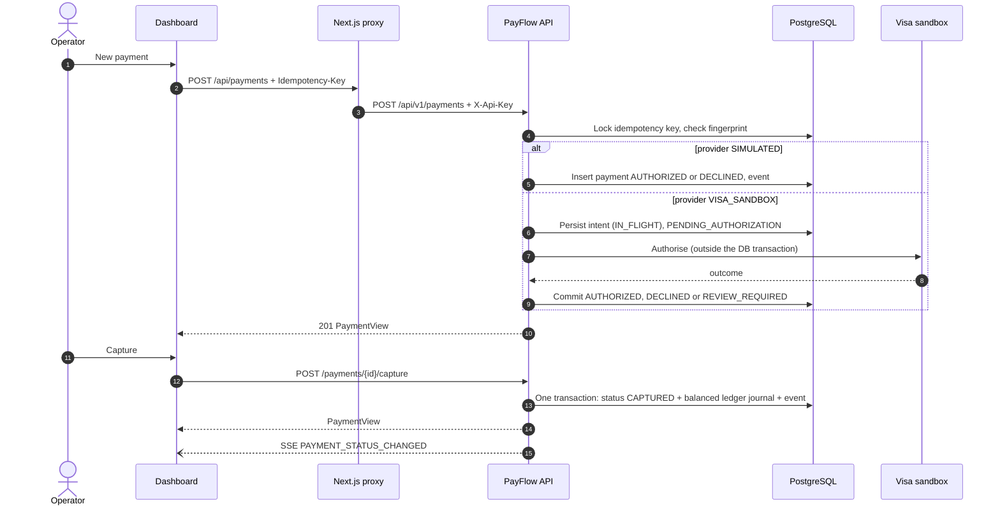
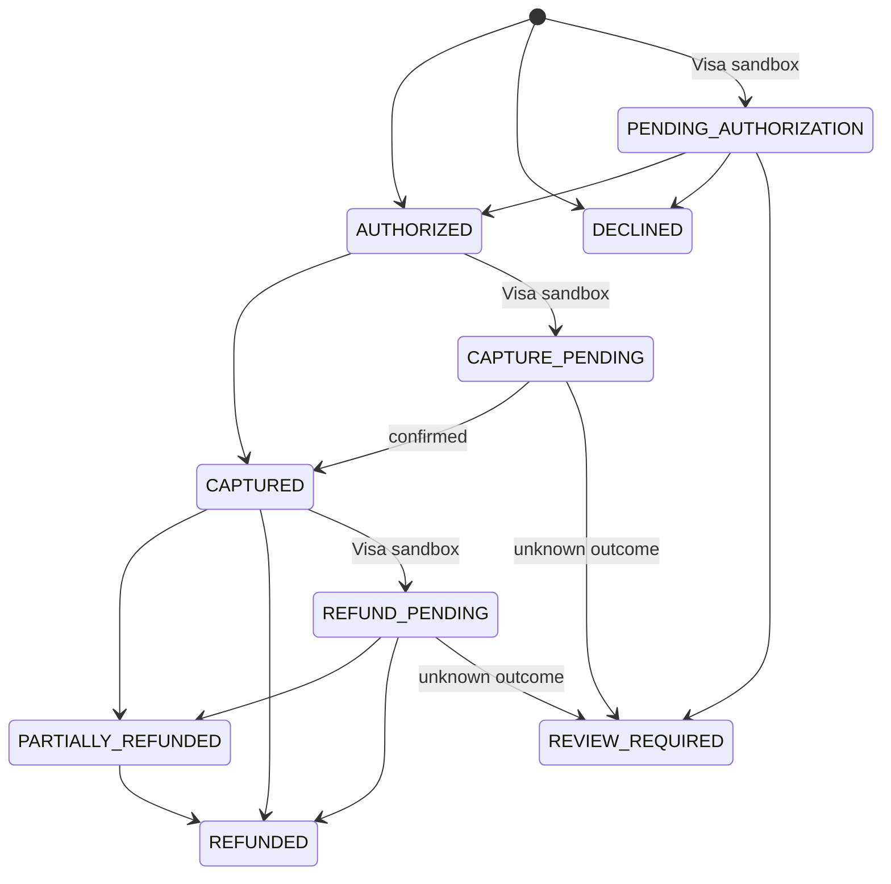
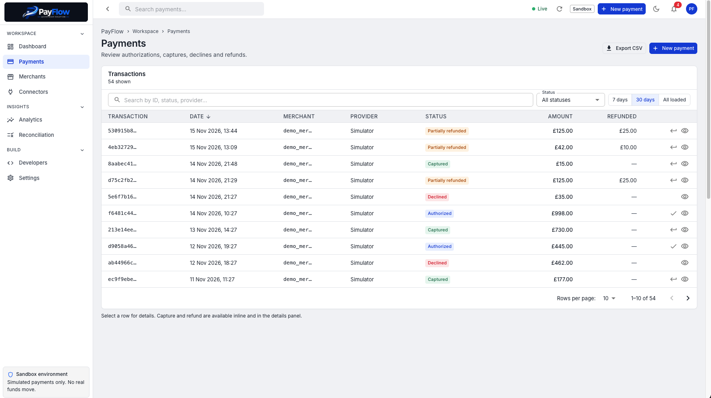
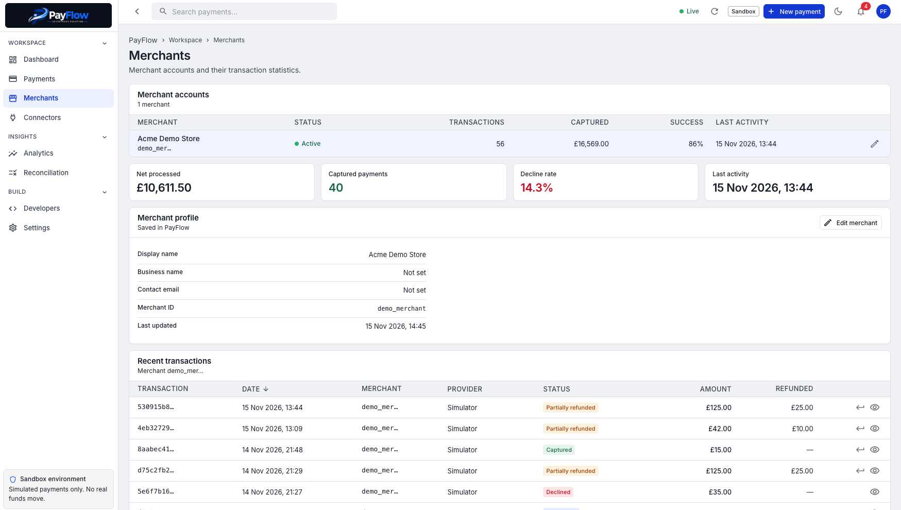

<p align="center">
  
</p>

<h1 align="center">PayFlow Acceptance Solution</h1>

<p align="center">
  A sandbox payment-acceptance platform: a Next.js operations dashboard, a Spring Boot payments API with a double-entry ledger, an optional Visa Acceptance sandbox integration, and a Jenkins CI pipeline.
</p>

<p align="center">
  
  
  
  
  
  
  
  
  
  
  
  
</p>

<p align="center">
  <sub>
    <strong>All badges on this page are static.</strong> None updates automatically.
    "Pipeline: passing" reflects Jenkins build #1 of the <code>PayFlow-CI-CD</code> validation job (see <a href="#jenkins-cicd-pipeline">Jenkins CI/CD Pipeline</a>); it is not a live status and does not describe the full <code>Jenkinsfile</code>.
    "Frontend tests" is the result of a local run on 2026-11-27 (see <a href="#testing-and-quality-assurance">Testing</a>).
    GitHub repository: <a href="https://github.com/domwokorach/PayFlow-Acceptance-Solution">domwokorach/PayFlow-Acceptance-Solution</a>.
  </sub>
</p>

> **Sandbox only.** All payments are simulated, or sent to the Visa Acceptance **test** environment with test credentials. No real money moves. PayFlow is an independent portfolio project: it is **not** an official Visa product, is **not affiliated with or endorsed by Visa**, and holds **no** PCI DSS, SOC 2, ISO 27001 or GDPR certification. Never enter real card data.

## Table of Contents

1. [Repository status (read first)](#repository-status-read-first)
2. [Project overview](#project-overview)
3. [Features and functionality](#features-and-functionality)
4. [Technology stack](#technology-stack)
5. [System architecture](#system-architecture)
6. [Repository structure](#repository-structure)
7. [Installation and getting started](#installation-and-getting-started)
8. [Environment variables](#environment-variables)
9. [Docker infrastructure](#docker-infrastructure)
10. [Jenkins CI/CD Pipeline](#jenkins-cicd-pipeline)
11. [Testing and quality assurance](#testing-and-quality-assurance)
12. [API documentation](#api-documentation)
13. [Payment processing and transaction lifecycle](#payment-processing-and-transaction-lifecycle)
14. [UI/UX and design](#uiux-and-design)
15. [Security and compliance](#security-and-compliance)
16. [Troubleshooting](#troubleshooting)
17. [Development and contribution](#development-and-contribution)
18. [Roadmap and project status](#roadmap-and-project-status)
19. [Licence and copyright](#licence-and-copyright)

---

## Repository status (read first)

This README was written from an audit on **2026-11-27**. The audit found that the platform is split across three places, and the documentation below says which one each fact came from.

| Component | Where it is | Verified how |
|---|---|---|
| **Dashboard (Next.js)** | `frontend/`, a **nested Git repository** (branch `fix/production-api`, same GitHub remote). It is the newest copy and includes sign-in, the hardened proxy and the health endpoint. The repository root also holds an **older copy** of the dashboard (`app/`, `lib/`, `components/`, `tests/`) without sign-in. | Read the source; ran its tests, type check, lint and coverage. |
| **Backend (Spring Boot), `docker-compose.yml`, `Jenkinsfile`, `infrastructure/ci/`, `observability/`, `.github/workflows/`** | **Not in the working tree.** They exist only in the local Jenkins snapshot at `infrastructure/jenkins/local-repo/payflow.git` (commit `0b3e087`, "Snapshot for local Jenkins build"). `backend/` on disk contains only build output (`backend/target/`, including `payflow-api-0.1.0.jar` and test reports). | Read from an extracted copy of the snapshot. **Not built or run during the audit.** |
| **Jenkins screenshot** | `docs/images/jenkins-ci-cd-pipeline.{webp,png}` | Viewed. |

Consequences you should know about:

- The public GitHub repository does not yet contain the backend, `Jenkinsfile` or Compose file. The Jenkins job's own checkout stage fails if `backend/` or `frontend/` is missing. See [Jenkins setup](#jenkins-cicd-pipeline) and the [roadmap](#roadmap-and-project-status).
- The snapshot is **older** than `frontend/`: its dashboard has no sign-in and uses Node 22, while `frontend/` requires Node 24. See [Known limitations](#known-limitations).
- Commands in this README that need the backend or Compose file assume the full platform layout (`backend/`, `frontend/`, `infrastructure/`, `docker-compose.yml` at one root), as in the snapshot.

## Project overview

**PayFlow Acceptance Solution** is a payment-acceptance sandbox. It lets an operator authorise, capture and refund card payments for a merchant, watch the transactions arrive live, reconcile them against a ledger, and inspect provider health, all without touching real funds.

**Problem it addresses.** Payment acceptance is hard to get right: requests are retried, networks time out, providers return "pending", and money records must stay balanced. PayFlow demonstrates how to handle those cases deliberately: idempotent writes, state transitions in one database transaction, a balanced ledger, read-only reconciliation of unknown provider outcomes, and per-merchant isolation.

**What it does**

- **Payment processing.** Create (authorise), capture and refund payments through a REST API. Amounts are integer minor units (GBP pence in the demo).
- **Merchant management.** List merchants and edit a merchant's display name, contact email and business name. Merchants are isolated from each other by API key.
- **Provider integrations.** A built-in `SIMULATED` provider, and an optional `VISA_SANDBOX` provider that calls the Visa Acceptance test API (`https://apitest.visaacceptance.com`) with a fixed published test-card fixture.
- **Dashboard and analytics.** Live payment table, volume, success versus decline, refund trend, status breakdown, provider health and a reconciliation report.

**Target users and use cases.** Engineers and reviewers evaluating payment-system design; developers prototyping against a payments API; and the repository owner as a software-engineering and DevOps portfolio piece.

**Sandbox and production-readiness limits.** It is not production-ready. There is no real settlement or payout, no real card data handling, no multi-user roles, and no external security assessment. See [Security and compliance](#security-and-compliance) and [Known limitations](#known-limitations).

**Objectives.** Show correct payment-state handling, clean API design, a tested dashboard, containerised delivery, and a CI pipeline with quality gates.

## Features and functionality

Status key: **Implemented** (verified in source), **Partial**, **Planned**. Paths are relative to the platform layout; backend paths are from the Jenkins snapshot.

| Feature | Status | Purpose and implementation | Source |
|---|---|---|---|
| Dashboard overview | Implemented | KPI cards and charts from `GET /api/v1/dashboard/summary`. | `frontend/app/page.tsx`, `frontend/lib/summary.ts` |
| Payments | Implemented | Searchable, filterable table (status, 7/30 days), detail drawer, create, capture, refund, CSV export. | `frontend/app/payments/page.tsx`, `frontend/components/payments/` |
| Payment processing | Implemented | Authorise, capture, partial and full refund; idempotent; ledger entries on capture and refund. | `backend/.../core/PaymentService.java`, `Ledger.java`, `Idempotency.java` |
| Transaction status monitoring | Implemented | Status chips, and live updates over Server-Sent Events with resume and a resync fallback. | `frontend/lib/live.ts`, `frontend/app/api/events/stream/route.ts`, `backend/.../events/` |
| Merchants | Implemented | Merchant list with volume and success rate; edit profile dialog. | `frontend/app/merchants/page.tsx`, `frontend/components/merchants/EditMerchantDialog.tsx`, `backend/.../api/MerchantController.java` |
| Merchant onboarding | **Not implemented** | There is no create-merchant endpoint or UI. Merchants and their API keys are registered at backend start-up from `PAYFLOW_DEMO_API_KEY` and `PAYFLOW_BOOTSTRAP_KEYS`. | `backend/.../security/ApiKeyBootstrap.java` |
| Connections (Connectors) | Implemented | Lists providers with health derived from persisted provider operations. | `frontend/app/connectors/page.tsx` |
| Analytics | Implemented | Volume, success versus decline, refunds, status and hourly activity charts (Recharts). | `frontend/app/analytics/page.tsx`, `frontend/components/charts/charts.tsx`, `frontend/lib/analytics.ts` |
| Reconciliation | Implemented | Payments awaiting the provider or review, ledger balance and discrepancy checks; per-payment reconcile for Visa sandbox payments. | `frontend/app/reconciliation/page.tsx`, `backend/.../core/ReconciliationService.java` |
| Developers page | Implemented | Endpoint reference with copyable examples. | `frontend/app/developers/page.tsx` |
| Notifications | Implemented | Toasts plus a notification centre (types: success, error, warning, info; categories: payment, merchant, provider, dashboard, account, system). Held in the browser tab's memory only; not stored on the server. | `frontend/components/notifications/`, `frontend/lib/notifications/` |
| Authentication | Implemented (dashboard only) | Single operator account, signed-cookie session, login rate limit. Required in public deployments. Not an OAuth2/OIDC or multi-user system. | `frontend/proxy.ts`, `frontend/lib/server/`, `frontend/app/login/`, `frontend/app/api/auth/` |
| API authentication | Implemented | Per-merchant API keys, stored as SHA-256 digests, revocable. | `backend/.../security/` |
| Session management | Implemented | HMAC-SHA-256 signed cookie, 8-hour lifetime, `HttpOnly`, `SameSite=Lax`, `Secure` and `__Host-` prefix in public mode. | `frontend/lib/server/session.ts` |
| Error handling | Implemented | Backend returns `{"error": …}` (plus `fields` for validation); the proxy hides upstream 5xx bodies and shows "Payment API unavailable" when the backend is unreachable. | `backend/.../api/ApiExceptionHandler.java`, `frontend/app/api/[...path]/route.ts`, `frontend/components/ui/ApiError.tsx` |
| Real-time updates | Implemented | Transactional outbox (`domain_events`) feeds an SSE stream; heartbeats every 15 s; client reconnects with back-off. | `backend/src/main/resources/db/migration/V3__domain_events_audit.sql`, `frontend/lib/live.ts` |
| Responsive design | Partial | Collapsible navigation and MUI responsive layout. Not verified on a device matrix. | `frontend/components/shell/AppShell.tsx` |
| Accessibility | Partial | Colour contrast is unit-tested; focus rings and ARIA labels are present. No automated accessibility audit (axe, Lighthouse) is configured. | `frontend/tests/contrast.test.ts`, `frontend/lib/theme.ts` |
| Animated icons | Implemented | Motion-driven notification icons and animated count-up metrics. | `frontend/components/notifications/icons/`, `frontend/hooks/useCountUp.ts` |
| Light and dark modes | Implemented | MUI colour schemes with a header toggle. | `frontend/lib/theme.ts`, `frontend/components/shell/AppShell.tsx` |
| Settlement and payouts | **Not implemented** | The ledger records capture and refund journals only. No settlement file, payout or bank transfer exists. | — |
| Webhooks, OAuth2/OIDC, RBAC | **Planned** | See [roadmap](#roadmap-and-project-status). | `docs/roadmap.md` (snapshot) |

## Technology stack

Versions are taken from `frontend/package.json` and `frontend/package-lock.json` (as installed, via `npm ls`), `backend/pom.xml`, the Dockerfiles and Compose files in the snapshot. Frontend ranges in `package.json` use `^`; the "Installed" column is what the lockfile resolved on 2026-11-27.

| Category | Technology | Version | Source |
|---|---|---|---|
| Languages | TypeScript | 5.9.3 | `frontend/package.json` |
| | Java | 21 | `backend/pom.xml` |
| Frontend framework | Next.js (App Router, Turbopack) | 16.4.6 | `frontend/package.json` |
| | React / React DOM | 19.3.1 | lockfile |
| UI components | Material UI (`@mui/material`, icons, Next.js integration) | 9.5.0 | `frontend/package.json` |
| Styling and animation | Emotion | 11.14.x | `frontend/package.json` |
| | Motion | 14.14.0 | `frontend/package.json` |
| | Inter variable font (`@fontsource-variable/inter`) | ^5.3.0 | `frontend/package.json` |
| Charts and icons | Recharts / lucide-react | 3.10.1 / 1.73.0 | `frontend/package.json` |
| Data fetching | TanStack Query | 5.107.1 | `frontend/package.json` |
| Backend framework | Spring Boot (Web MVC, JDBC, Validation, Security, Actuator) | 4.1.2 | `backend/pom.xml` |
| Database | PostgreSQL | 17 (`postgres:17-alpine`) | `docker-compose.yml` |
| Migrations | Flyway (`V1`–`V5`) | managed by Spring Boot | `backend/src/main/resources/db/migration/` |
| External API | Visa Acceptance sandbox (`apitest.visaacceptance.com`), JWT (HS256 shared secret) | — | `backend/.../visa/` |
| Observability | Micrometer + Prometheus, OpenTelemetry (OTLP), Grafana | Prometheus v3.5.0, Grafana 12.1.0, OTel Collector 0.131.0 | `docker-compose.yml`, `observability/` |
| Frontend testing | Vitest, Testing Library, jsdom, V8 coverage | 3.2.7, 16.3.3, 31.x, 3.2.7 | `frontend/package.json` |
| Backend testing | JUnit 5, Mockito, Spring Boot Test, Testcontainers, JaCoCo | JaCoCo 0.8.13 | `backend/pom.xml` |
| Linting | ESLint, `eslint-config-next`, `tsc --noEmit` | 9.39.5 | `frontend/package.json` |
| Containers | Docker, Docker Compose | Maven 3.9.11 + Temurin 21 (build), Node 24-alpine (`frontend/Dockerfile`) | Dockerfiles |
| CI/CD | Jenkins LTS (JDK 21 controller), inbound agent, Docker-in-Docker 27 | — | `infrastructure/jenkins/` |
| Security tooling | gitleaks 8.28.0, Trivy 0.69.3 | — | `infrastructure/jenkins/agent/Dockerfile` |
| Design tools | Figma | **No Figma file or link exists in the repository.** Design is implemented as MUI theme tokens. | `frontend/lib/theme.ts` |

## System architecture

The browser never talks to the backend or holds an API key. It calls same-origin `/api/*` routes on the Next.js server, which checks the session, applies an allowlist, adds the backend API key and forwards the request.



**Request flow.** (1) The browser sends `POST /api/payments` with an `Idempotency-Key`. (2) The proxy verifies the session cookie, checks the method and path against an allowlist, checks same-origin for mutations, limits the body to 16 KiB and rebuilds the headers from scratch. (3) The backend authenticates the API key, resolves the merchant, validates the body and runs the state change and ledger write in one database transaction. (4) The response returns through the proxy. Upstream 5xx bodies are replaced with a generic error; 4xx bodies (validation messages) pass through.

**Live updates.** State changes write a row to `domain_events` in the same transaction. The backend streams rows to the merchant over SSE. The browser's `connectLive` client reconnects with the last event id; if the backend cannot replay, the client refetches everything.

**There is no separate API gateway service.** The Next.js proxy fills that role. Authentication for the dashboard is the signed session; authentication for the API is the per-merchant API key.

### CI/CD architecture



## Repository structure

Platform layout (backend and CI files exist only in the Jenkins snapshot; see [Repository status](#repository-status-read-first)). A file-by-file description is in [`docs/repository-structure.md`](docs/repository-structure.md).

```text
.
├── frontend/                      # Next.js dashboard (nested Git repo, newest)
│   ├── app/                       # Routes: /, payments, merchants, connectors, analytics,
│   │   │                          #   reconciliation, developers, settings, login
│   │   └── api/                   # auth/{login,logout,session}, health, events/stream, [...path] proxy
│   ├── components/                # shell, payments, merchants, notifications, charts, ui, auth
│   ├── hooks/                     # useCountUp, useNotification
│   ├── lib/                       # api client, live updates, analytics, theme, types
│   │   └── server/                # config, session, policy, upstream, login-limit, log (server-only)
│   ├── tests/                     # 12 Vitest files
│   ├── proxy.ts                   # Page gate (Next.js proxy)
│   ├── Dockerfile  .env.example  .nvmrc  .npmrc  package.json
│   └── docs/deployment.md         # Vercel deployment notes
├── backend/                       # Spring Boot API (source: snapshot only)
│   └── src/main/java/dev/payflow/ # api, core, events, infra, model, security, visa
├── infrastructure/
│   ├── jenkins/                   # Controller, agent, CasC, bootstrap, local-repo snapshot
│   └── ci/                        # e2e.sh, coverage/report gates, dependency scan, hygiene (snapshot)
├── observability/                 # Prometheus, Grafana, OTel Collector configs (snapshot)
├── docker-compose.yml             # postgres, backend, frontend (+ observability profile) (snapshot)
├── Jenkinsfile                    # Declarative pipeline (snapshot)
├── .github/workflows/checks.yml   # GitHub Actions (snapshot)
├── docs/                          # This documentation, logo and screenshots
│   ├── images/                    # payments, merchants, developers, Jenkins screenshot
│   ├── api-reference.md
│   └── repository-structure.md
├── README.md  SECURITY.md  LICENSE.md  COPYRIGHT
└── Dockerfile  .env.example       # Older root-level dashboard copy (see Repository status)
```

## Installation and getting started

### System requirements

| Need | Version | Why |
|---|---|---|
| Git | any recent | Clone |
| Node.js and npm | **Node `^24.15.0`**, npm ≥ 10 (`frontend/package.json` `engines`, `engine-strict=true`) | Dashboard |
| Docker Desktop or Docker Engine with Compose v2 | recent | Full stack |
| Java and Maven | JDK 21, Maven 3.9 | Backend without Docker |

Install Node 24 with `nvm install` inside `frontend/` (it reads `.nvmrc`). Works on macOS, Linux and Windows; on Windows use WSL 2 with Docker Desktop for the shell commands, or PowerShell with `Copy-Item` in place of `cp`.

### Clone

```bash
git clone https://github.com/domwokorach/PayFlow-Acceptance-Solution.git
cd PayFlow-Acceptance-Solution
```

### Dashboard only (against an existing API)

```bash
cd frontend
nvm use                  # Node 24
npm ci
npm run dev              # http://localhost:3000
```

With no environment variables set, local mode defaults to `http://localhost:8080` and the local demo key, with **no login**. If no backend is running every call shows "Payment API unavailable — check Docker services".

### Full stack with Docker (platform layout)

```bash
# at the platform root, where docker-compose.yml lives
cp .env.example .env     # optional: Visa sandbox credentials; leave PAYFLOW_VISA_ENABLED=false for the simulator
docker compose up -d --build postgres backend frontend
```

The database schema is created by Flyway when the backend starts. There is no manual initialisation step. For synthetic history, set `PAYFLOW_SEED_DEMO_DATA=true` (applies only with the `demo` profile, which the Compose file enables, and only to an empty database).

### Verify

```bash
docker compose ps
curl -s http://localhost:8080/actuator/health          # {"status":"UP"}
curl -s http://localhost:3000/api/health                # {"status":"ok","web":"up","api":"up"}
open http://localhost:3000                              # macOS; use xdg-open on Linux
```

### Stop and restart

```bash
docker compose stop               # keep data
docker compose up -d              # start again
docker compose down               # remove containers, keep the postgres_data volume
docker compose down -v            # also delete the database volume
```

### Production build of the dashboard

```bash
cd frontend && npm run build && npm run start
```

## Environment variables

Real values go in a local, untracked `.env` (root) or `frontend/.env.local`. Only placeholders are committed. **None of the dashboard variables may be prefixed `NEXT_PUBLIC_`.**

### Dashboard (`frontend/`)

| Variable | Purpose | Required | Safe example |
|---|---|---|---|
| `PAYFLOW_API_ORIGIN` | Backend origin used by the server proxy. Bare origin, no path. HTTPS and non-private host in public mode. | Local: no (default `http://localhost:8080`). Public: **yes** | `https://api.example.com` |
| `PAYFLOW_DEMO_API_KEY` | API key the proxy sends as `X-Api-Key`. Must equal the backend's key. In public mode: 32+ characters and not the local key. | Local: no. Public: **yes** | `<32+ random characters>` |
| `PAYFLOW_DASHBOARD_USER` | Sign-in user name (default `operator`). | No | `operator` |
| `PAYFLOW_DASHBOARD_PASSWORD` | Sign-in password, 14+ characters. | Public: **yes** | `<14+ characters>` |
| `PAYFLOW_SESSION_SECRET` | Cookie-signing secret, 32+ characters, different from the password. | Public: **yes** | `<32+ random characters>` |
| `PAYFLOW_API_TIMEOUT_MS` | Upstream timeout, 1000–25000 (default 10000). | No | `10000` |
| `PAYFLOW_PUBLIC_DEPLOYMENT` | Force public-deployment rules outside Vercel. | No | `true` |
| `VERCEL` | Set by Vercel; also enables public rules. | Platform-set | `1` |

If any public-mode value is missing or weak, every page and API call returns `503 "Service is not configured"`; the variable names (never values) are logged. Generate secrets with `openssl rand -base64 36`.

### Backend (`backend/src/main/resources/application.yml`, `docker-compose.yml`)

| Variable | Purpose | Required | Safe example |
|---|---|---|---|
| `DB_URL` or `DB_HOST`/`DB_PORT`/`DB_NAME` | JDBC connection. | Yes (defaults to `localhost:5432/payflow`) | `jdbc:postgresql://postgres:5432/payflow` |
| `DB_USER`, `DB_PASSWORD` | Database credentials (defaults `payflow` / `payflow_local`, local only). | Change outside localhost | `payflow` |
| `PORT` | HTTP port (default 8080). | No | `8080` |
| `PAYFLOW_DEMO_API_KEY` | Key registered for `demo_merchant` (default `local-only-change-me`). | Yes | `<random>` |
| `PAYFLOW_BOOTSTRAP_KEYS` | Extra keys as `merchantId=key,other=key`. Keys under 16 characters are refused; keys no longer listed are revoked. | No | `acme=<random>` |
| `PAYFLOW_REQUIRE_STRONG_KEYS` | Refuse the local key and keys under 32 characters (present in the built jar's `application.yml`; not in the snapshot's). | Set `true` on any reachable host | `true` |
| `PAYFLOW_VISA_ENABLED` | Enable the Visa sandbox provider (default `false`). | No | `false` |
| `PAYFLOW_VISA_MERCHANT_ID`, `PAYFLOW_VISA_KEY_ID`, `PAYFLOW_VISA_SHARED_SECRET` | Visa sandbox credentials. Never commit. | Only if Visa is enabled | `your_sandbox_…` |
| `PAYFLOW_SEED_DEMO_DATA` | Synthetic history, `demo` profile only. | No | `false` |
| `SPRING_PROFILES_ACTIVE` | `demo` in Compose. | No | `demo` |
| `PAYFLOW_RECONCILER_ENABLED`, `PAYFLOW_RECONCILER_INTERVAL_MS` | Pending Visa operation reconciler (default on, 30000 ms). | No | `true`, `30000` |
| `PAYFLOW_OTLP_ENABLED`, `PAYFLOW_OTLP_ENDPOINT`, `PAYFLOW_TRACE_SAMPLING` | OpenTelemetry export. | No | `false` |
| `PAYFLOW_ACTUATOR_EXPOSURE` | Actuator endpoints (default `health,info,prometheus`). | No | `health,info,prometheus` |
| `GRAFANA_ADMIN_PASSWORD` | Grafana admin password, `observability` profile (default `payflow-local`). | Change if exposed | `<password>` |

### Jenkins (`infrastructure/jenkins/.env`, created by `bootstrap.sh`, mode 600, git-ignored)

`JENKINS_ADMIN_PASSWORD`, `JENKINS_AGENT_PASSWORD` (both generated), `PAYFLOW_GIT_URL`, `PAYFLOW_GIT_BRANCH`, `PAYFLOW_GIT_CREDENTIALS_ID`.

### Consistency findings

- `frontend/.env.example` documents the dashboard variables; the root `.env.example` documents only the Visa and seed variables used by Compose. Both are accurate for their purpose but are not one file.
- Compose passes only `PAYFLOW_API_ORIGIN` and `PAYFLOW_DEMO_API_KEY` to the frontend, so the Compose stack runs the dashboard in **local mode without sign-in**.
- `PAYFLOW_REQUIRE_STRONG_KEYS` is missing from the snapshot's `application.yml` and `docker-compose.yml`.

## Docker infrastructure

From `docker-compose.yml` (project name `payflow`). All ports bind to `127.0.0.1`.

| Service | Image / build | Port (host → container) | Volume | Health check | Depends on |
|---|---|---|---|---|---|
| `postgres` | `postgres:17-alpine` | 5433 → 5432 | `postgres_data` | `pg_isready -U payflow -d payflow` | — |
| `backend` | `./backend` (Maven 3.9.11 / Temurin 21 build; `eclipse-temurin:21-jre` runtime) | 8080 → 8080 | — | none defined | `postgres` (healthy) |
| `frontend` | `./frontend` (Node build and runtime) | 3000 → 3000 | — | none defined | `backend` |
| `prometheus` * | `prom/prometheus:v3.5.0` | 9090 → 9090 | `observability/prometheus.yml` | — | `backend` |
| `grafana` * | `grafana/grafana:12.1.0` | 3001 → 3000 | provisioning and dashboards | — | `prometheus` |
| `otel-collector` * | `otel/opentelemetry-collector:0.131.0` | — | `observability/otel-collector.yml` | — | — |

\* Optional: `docker compose --profile observability up -d`. `postgres`, `backend` and `frontend` use `restart: unless-stopped`. All services share the default Compose network, so the frontend reaches the API at `http://backend:8080`.



**Commands**

```bash
docker compose up -d --build            # build and start
docker compose ps
docker compose logs -f backend          # also: frontend, postgres
docker compose restart backend
docker compose exec postgres psql -U payflow -d payflow
```

Compose reads `.env` only when a container is created; after editing it run `docker compose up -d --build <service>`.

**Observed gaps (not changed).** `backend` and `frontend` have no health checks; the backend's `/actuator/health` is available for adding one. The Compose file's Postgres password and demo key are local-only placeholders.

### Troubleshooting "Payment API unavailable — check Docker services"

This message comes from the dashboard proxy (`frontend/lib/server/upstream.ts`) when it cannot reach the backend. In public mode the text is shortened to "Payment API unavailable. Please try again shortly."

```bash
docker compose ps                                   # is backend "Up"? did it restart?
docker compose logs --tail=100 backend              # Flyway or datasource errors, port clashes
curl -s http://localhost:8080/actuator/health       # expect {"status":"UP"}
curl -s http://localhost:3000/api/health            # shows web up, api up or down
docker compose exec frontend printenv PAYFLOW_API_ORIGIN   # must be http://backend:8080 in Compose
```

If the dashboard runs on the host (`npm run dev`) the origin must be `http://localhost:8080`; if it runs in Compose it must be `http://backend:8080`. A `502 "Payment API rejected the service credentials"` means the dashboard's `PAYFLOW_DEMO_API_KEY` does not match the backend's.

## Jenkins CI/CD Pipeline

<p align="center">
  <picture>
    <source srcset="docs/images/jenkins-ci-cd-pipeline.webp" type="image/webp">
    
  </picture>
</p>
<p align="center"><em>Figure 1. Jenkins Stages view for pipeline <code>PayFlow-CI-CD</code>, build #1: successful, 7.8 seconds.</em></p>

**What the screenshot shows (verified from the image):** pipeline `PayFlow-CI-CD`, build **#1**, status **successful**, **7.8 s**, started by the repository owner. Stages: Initialisation (0.26 s), Pipeline Validation (0.14 s), CI/CD Readiness (0.6 s), Complete (0.22 s), Post Actions (0.47 s). The log line reads "SUCCESS: PayFlow pipeline completed".

**What it does not show.** These five stages are a lightweight validation job. They are **not** the stages of the repository's `Jenkinsfile`, and the job definition behind the screenshot is not in the repository. The run does not demonstrate automated tests, security scans, Docker builds or deployments, and none is claimed.

### The repository `Jenkinsfile` (snapshot)

Declarative pipeline on agent label `payflow-agent` (JDK 21, Maven, Node, Docker CLI, gitleaks, Trivy). Options: timestamps, ANSI colour, no concurrent builds, 75-minute timeout, keep 30 builds. **It does not deploy anything.** I read it; **no execution of this pipeline was observed during the audit.**

| # | Stage | What it does |
|---|---|---|
| 1 | Checkout | Clean workspace, `checkout scm`, verify `backend/pom.xml`, `frontend/package.json`, `frontend/package-lock.json` and `infrastructure/ci/e2e.sh` exist. |
| 2 | Tooling and Docker preflight | Requires Java 21 and **Node 22**; prints Docker daemon info. |
| 3 | Backend Build | `mvn validate dependency:resolve`, then `clean package -DskipTests`. |
| 4 | Backend Unit Tests | `mvn test -Dtest='!*IntegrationTest'`; JUnit publish; `verify_reports.py` requires ≥ 40 tests and named classes. |
| 5 | Backend Integration Tests | `*IntegrationTest` with Testcontainers PostgreSQL 17 (Visa gateway mocked); requires ≥ 30 tests. |
| 6 | Frontend Install | `npm ci`. |
| 7 | Frontend Quality Checks | `typecheck`, `lint:eslint`, `test:ci`; JUnit; requires ≥ 80 tests and named suites. |
| 8 | Frontend Production Build | `npm run build`. |
| 9 | End-to-End (isolated stack) | Parameter `RUN_E2E` (default true). `infrastructure/ci/e2e.sh` builds and runs the stack in the Docker-in-Docker daemon, runs `e2e_payment_flow.py`, always tears down. Simulator only. |
| 10 | Security Checks | `repo-hygiene.sh`; gitleaks on history and on reports/logs; dependency scan (HIGH/CRITICAL fixable findings → UNSTABLE; scan failure → FAILURE). |
| 11 | Visa Sandbox Smoke (optional) | Parameter `RUN_SANDBOX_SMOKE` (default false). Two real sandbox calls using Jenkins credentials. |
| 12 | Coverage and Reports | JaCoCo report; `coverage_gate.py` with thresholds 40 % (backend) and 50 % (frontend), below which the build is UNSTABLE; archive jar and reports. |
| 13 | Build Result | Summary echo. |

**Result policy.** SUCCESS: every required stage passed and reports prove essential tests ran. UNSTABLE: passed but a gate was missed. FAILURE: a build, test, security or verification step failed, or required tests did not run. Post actions: archive reports always, `cleanWs` on cleanup.

### Jenkins installation (snapshot `infrastructure/jenkins/`)

```bash
cd infrastructure/jenkins
./bootstrap.sh https://github.com/<owner>/<repo>.git     # creates .env (mode 600) with generated passwords
docker compose up -d --build                              # about 5 minutes the first time
open http://localhost:8081                                # user: admin; password in .env
```

Without GitHub: `./make-local-repo.sh`, then `docker compose -f docker-compose.yml -f docker-compose.local-repo.yml up -d --build` (this is how the `local-repo/payflow.git` snapshot was produced).

Design: the controller has 0 executors and no Docker access; the agent connects with a user limited to `Overall/Read` and `Agent/Connect`; builds use an isolated privileged Docker-in-Docker daemon over mutual TLS, so the host Docker is never touched. Jenkins binds to `127.0.0.1:8081`. Configuration is declarative (`casc/jenkins.yaml`, plugins in `controller/plugins.txt`). Triggers: GitHub push (needs a tunnel to localhost) and an SCM poll every 15 minutes. Full details: the snapshot's `docs/jenkins-setup.md`.

GitHub Actions (`.github/workflows/checks.yml`, snapshot) runs independently on push and pull request: `mvn -B test` (Java 21) and, for the frontend, `npm install`, `npm run lint`, `npm test`, `npm run build` on **Node 22**.

### Jenkins troubleshooting

| Symptom | Likely cause | Check and fix |
|---|---|---|
| Checkout fails: "Missing backend/pom.xml…" | The Git remote contains only the dashboard. | `git ls-files \| grep -c '^backend/'` must not be 0. See [Repository status](#repository-status-read-first). |
| Preflight fails on Node version, or `npm ci` fails with an engine error | Pipeline and agent expect Node 22; current `frontend/` requires `^24.15.0` with `engine-strict`. | Align the agent image and `Jenkinsfile` with Node 24. |
| "no space left on device" | Docker disk image full. | `docker builder prune`. |
| Tests "did not run" | `verify_reports.py` found fewer tests than the minimum. | Open the stage's JUnit report. |
| Cannot reach GitHub webhooks | Jenkins is localhost-only. | Use a tunnel, or rely on 15-minute polling. |

## Testing and quality assurance

### Frontend (executed 2026-11-27, in `frontend/`, Node 24.22.3)

| Check | Command | Result |
|---|---|---|
| Unit, component and route tests | `npm test` | **12 files, 148 tests passed, 0 failed, 0 skipped** (3.8 s) |
| Type check | `npm run typecheck` | Passed |
| ESLint | `npm run lint:eslint` | 0 errors, 7 warnings (unused variables in tests) |
| Coverage | `npm run test:coverage` | Lines 57.54 % (1376/2391), branches 86.72 %, functions 68.81 % |

| Test file | Tests | Covers |
|---|---|---|
| `server-routes.test.ts` | 23 | Proxy allowlist, same-origin check, upstream handling |
| `server-config.test.ts` | 12 | Fail-closed configuration, public versus local rules |
| `server-session-policy.test.ts` | 9 | Session signing and expiry, login throttling |
| `login-form.test.tsx` | 2 | Login form |
| `notification-utils.test.ts` / `notifications-ui.test.tsx` | 24 / 24 | Notification logic and UI |
| `payment-ui.test.tsx` | 11 | Create, capture and refund flows |
| `merchants.test.ts` | 12 | Merchant data helpers |
| `live.test.ts` | 8 | SSE reconnect, de-duplication, resume |
| `countup.test.ts` | 9 | Count-up animation maths |
| `contrast.test.ts` | 13 | Colour contrast (accessibility) |
| `hydration.test.tsx` | 1 | No hydration mismatch |

`npm run test:ci` additionally writes `reports/junit.xml` and Cobertura output. Other scripts: `test:watch`, `test:coverage`.

### Backend (not re-run; existing evidence)

The backend source is not in the working tree, so the tests were **not executed** during the audit. `backend/target/surefire-reports/` holds reports from an earlier local run (a crash-dump file is dated 2026-11-24) for 13 test classes: **107 tests, 0 failures, 0 errors, 0 skipped**. Integration tests need Docker (Testcontainers).

| Level | Classes |
|---|---|
| Unit | `PaymentPolicyTest`, `IdempotencyTest`, `MerchantServiceTest`, `RequestValidationTest`, `ApiKeyPolicyTest`, `VisaAcceptanceGatewayTest`, `VisaJwtSignerTest`, `VisaConfigTest` |
| Integration | `MerchantApiIntegrationTest`, `MerchantIsolationIntegrationTest`, `VisaPaymentWorkflowIntegrationTest`, `PaymentEventsIntegrationTest`, `SseStreamIntegrationTest` |

### End-to-end, regression and gaps

- **End-to-end:** `infrastructure/ci/e2e_payment_flow.py` (snapshot) covers create, idempotent retry, capture, partial and full refund, details, dashboard and ledger consistency, live events, provider error mapping, merchant update, authentication and concurrency. Not executed during the audit.
- **No browser E2E** (Playwright/Cypress), **no automated accessibility audit**, and **no load tests** exist. There is no dedicated regression suite beyond the above.

## API documentation

Base path `/api/v1` on the backend (port 8080). Through the dashboard the same routes are available at `/api/*` (without `v1`) behind the session. Full request and response schemas, examples and error shapes are in [`docs/api-reference.md`](docs/api-reference.md).

| Method | Endpoint | Description |
|---|---|---|
| `GET` | `/api/v1/payments?q=&status=` | List payments |
| `POST` | `/api/v1/payments` | Create (authorise). Header `Idempotency-Key` required |
| `GET` | `/api/v1/payments/{id}` | Get one payment |
| `POST` | `/api/v1/payments/{id}/capture` | Capture. `Idempotency-Key` required |
| `POST` | `/api/v1/payments/{id}/refunds` | Refund. `Idempotency-Key` required |
| `POST` | `/api/v1/payments/{id}/reconcile` | Read-only status check for a pending Visa sandbox operation |
| `GET` | `/api/v1/dashboard/summary?days=30` | Totals, daily series, status counts, provider health |
| `GET` | `/api/v1/reconciliation` | Awaiting items, ledger balance, discrepancies |
| `GET` | `/api/v1/merchants` | List merchants |
| `PATCH` | `/api/v1/merchants/{merchantId}` | Update display name, contact email, business name |
| `GET` | `/api/v1/events/stream` | Server-Sent Events; resume with `Last-Event-ID` or `?lastEventId=` |
| `GET` | `/actuator/health`, `/actuator/info`, `/actuator/prometheus` | Unauthenticated operational endpoints |

All `/api/v1/**` calls require an API key as `X-Api-Key` (also accepted: `X-Demo-Api-Key`, or `Authorization: Bearer`). Dashboard-only routes: `POST /api/auth/login`, `POST /api/auth/logout`, `GET /api/auth/session`, `GET /api/health`.

```bash
curl -s -X POST http://localhost:8080/api/v1/payments \
  -H 'Content-Type: application/json' \
  -H 'X-Api-Key: local-only-change-me' \
  -H 'Idempotency-Key: demo_create_0001' \
  -d '{"amountMinor":12500,"currency":"GBP","simulateDecline":false}'
```

`local-only-change-me` is a documented local placeholder. Never use it off localhost.

External integration: Visa Acceptance sandbox, operations authorise (`POST /pts/v2/payments`), capture (`/pts/v2/payments/{id}/captures`) and refund (`/pts/v2/captures/{id}/refunds`). Official docs: <https://developer.visaacceptance.com/>.

## Payment processing and transaction lifecycle





| Stage | Behaviour (verified in source) |
|---|---|
| Validation | `amountMinor` positive and ≤ 100,000,000; `currency` three capitals (the demo accepts GBP only); `Idempotency-Key` 8–128 letters, digits, `-` or `_`; `provider` `SIMULATED` or `VISA_SANDBOX`. |
| Idempotency | Unique per merchant, row-locked; reusing a key with a different body gives `409`. A repeat returns the current payment projection, not a cached HTTP response. |
| Capture | Allowed only from `AUTHORIZED`; full amount only (no partial capture). |
| Refund | From `CAPTURED` or `PARTIALLY_REFUNDED`; over-refund gives `409`. |
| Ledger | One debit and one credit of equal amount per journal. Capture: debit `MERCHANT_CLEARING`, credit `MERCHANT_PAYABLE`; refund reverses. For Visa payments, entries post only on confirmed capture or refund. |
| Unknown provider outcome | Goes to `REVIEW_REQUIRED`; never blindly retried. A background reconciler (every 30 s) uses read-only lookups for operations awaiting the provider. |
| Settlement | **Not implemented.** |
| History | Payments list, audit log and domain events tables. |

**Simulation versus live.** `SIMULATED` is a local stand-in. `VISA_SANDBOX` sends a fixed published test card to Visa's **test** host; no card data is accepted from browsers or stored. Neither performs live financial processing. `simulateDecline: true` forces a simulated decline.

## UI/UX and design

**Branding.** Logo: [`docs/logo-readme.png`](docs/logo-readme.png) (README) and `public/logo.png` (app). Typeface: Inter Variable.

**Palette** (`frontend/lib/theme.ts`, light mode): text `#1F2937`, panel `#FFFFFF`, accent `#3B82F6` (filled buttons use darker `#1D4ED8` for 6.7:1 contrast), success `#10B981`, error `#EF4444`, warning `#F59E0B`. Dark mode: primary `#60A5FA`, text `#E5E7EB`, success `#34D399`, error `#F87171`, warning `#FBBF24`.

**Layout and behaviour.** App shell with collapsible navigation (Workspace: Dashboard, Payments, Merchants, Connectors; Insights: Analytics, Reconciliation; Build: Developers, Settings), a header with search, live indicator, sandbox badge, refresh, new payment, theme toggle, notifications and profile. A "Sandbox environment" notice sits in the sidebar. Notifications appear as toasts and in a notification centre.

**Figma.** No Figma file, link or export exists in the repository, so no Figma reference is made. The design is implemented directly in the MUI theme.

<p align="center">
  <br>
  <em>Payments</em>
</p>
<p align="center">
  <br>
  <em>Merchants</em>
</p>
<p align="center">
  <br>
  <em>Developers</em>
</p>

Three further unnamed screenshots (`docs/Screenshot 2026-11-16 at …png`) are kept as they are.

## Security and compliance

**Implemented controls** (verified in source)

| Area | Control | Where |
|---|---|---|
| Dashboard authentication | Single operator sign-in, constant-time comparison, generic error message. | `frontend/app/api/auth/login/route.ts` |
| Sessions | HMAC-SHA-256 signed token, 8 h, `HttpOnly`, `SameSite=Lax`, `Secure` and `__Host-` in public mode. | `frontend/lib/server/session.ts` |
| Page and API gating | Pages redirect to `/login`; API routes require a session; misconfiguration fails closed with 503. | `frontend/proxy.ts`, `lib/server/auth.ts` |
| Proxy allowlist | Only the eight documented routes; others get 404 or 405. | `frontend/lib/server/policy.ts` |
| CSRF | Mutations need same-origin (`Sec-Fetch-Site` / `Origin`). | `policy.ts` |
| Input limits | Body 16 KiB, query 512 characters, idempotency key ≤ 128 characters. | `policy.ts`, proxy route |
| Credential handling | API key and secrets server-side only; upstream headers rebuilt from scratch; no `NEXT_PUBLIC_` secrets. | `lib/server/upstream.ts` |
| Merchant isolation | Server-held key binds every request to one merchant; HTTP-level isolation tests including SSE. | `backend/.../security/`, `MerchantIsolationIntegrationTest` |
| API keys | SHA-256 digests only; revocable; minimum length 16 (32 with strong-keys mode). | `ApiKeyService`, `ApiKeyBootstrap` |
| Backend input validation | Bean Validation; structured field errors. | `model/*Dtos.java`, `ApiExceptionHandler` |
| Backend session policy | Stateless, CSRF off (no cookies exist), unmatched routes denied. | `SecurityConfig.java` |
| Rate limiting | Login only: 5 failures per 15 min per address, **per server instance**. | `lib/server/login-limit.ts` |
| Logging | Fixed non-sensitive fields only; no bodies, headers, keys or error messages. | `lib/server/log.ts` |
| Sensitive data | Amounts and IDs only; no card data accepted or stored. | `PaymentDtos.java` |
| Secret scanning | gitleaks on history and reports in Jenkins; `.env` hygiene check. | `Jenkinsfile`, `infrastructure/ci/` |
| Dependency scanning | Trivy-based scan in Jenkins (UNSTABLE on fixable HIGH/CRITICAL). | `infrastructure/ci/dependency-scan.sh` |

**Not implemented or not verified**

- **CORS:** no configuration exists; the browser only calls the same-origin proxy.
- **Security headers** (CSP, HSTS, X-Frame-Options): none set in `next.config.ts` or `proxy.ts`.
- **Backend rate limiting:** none. Add a platform rate-limit rule on `/api/auth/login` as `frontend/docs/deployment.md` advises.
- **Roles, OAuth2/OIDC, per-user audit identity, KMS-managed secrets:** not implemented.
- **Actuator:** `/actuator/prometheus` is unauthenticated by design; do not expose the backend publicly.
- **Certification:** PayFlow claims **no** PCI DSS, GDPR, SOC 2, ISO 27001 or Visa certification.

**Reporting a vulnerability.** Privately; see [SECURITY.md](SECURITY.md). Its authentication section describes the older, login-free dashboard and should be updated.

## Troubleshooting

| Issue | Likely cause | Diagnose | Resolve |
|---|---|---|---|
| "Payment API unavailable" | Backend down or wrong origin | `curl localhost:3000/api/health`; `docker compose logs backend` | Start backend; fix `PAYFLOW_API_ORIGIN` (see [above](#troubleshooting-payment-api-unavailable--check-docker-services)) |
| Docker services not running | Build or start failure | `docker compose ps`; `docker compose logs` | `docker compose up -d --build`; free disk with `docker builder prune` |
| Frontend 503 "Service is not configured" | Public mode with missing or weak variables | Server log `config_invalid` lists variable names | Set the required variables ([table](#dashboard-frontend)) |
| Frontend 502 "rejected the service credentials" | Dashboard key differs from backend key | Compare the two `PAYFLOW_DEMO_API_KEY` values | Make them equal; recreate containers |
| 504 "Payment API timed out" | Backend slow | Backend logs | Raise `PAYFLOW_API_TIMEOUT_MS` (max 25000) |
| Sign-in fails or redirects in a loop | Wrong credentials, or secret changed | Network tab for `/api/auth/login` status | Check password and secret; clear cookies |
| 429 on login | Throttle (5 failures) | Response `Retry-After: 900` | Wait 15 min |
| Missing environment variables | `.env` not created or not reloaded | `docker compose config` | Create `.env`; `docker compose up -d --build` |
| Port conflict (3000, 8080, 5433, 8081) | Another process | `lsof -nP -iTCP:8080 -sTCP:LISTEN` | Stop it or change the mapping |
| Database connectivity | Postgres unhealthy; wrong `DB_*` | `docker compose exec postgres pg_isready -U payflow` | Wait for healthy; check credentials |
| `npm ci` engine error | Wrong Node | `node -v` | `nvm use` (Node 24) |
| Backend 401 on API calls | Missing or revoked key | `curl -i … -H 'X-Api-Key: …'` | Use the configured key |
| Visa returns "503 Visa sandbox not configured" | Placeholder or empty credentials | Backend logs | Set all three `PAYFLOW_VISA_*` values and enable |
| Payment stuck in `*_PENDING` or `REVIEW_REQUIRED` | Provider outcome unknown | Reconciliation page; `POST …/reconcile` | Reconcile; manual review |
| Failed tests | Environment or code | `npm test`; for backend, Docker must run | Read the failing assertion; rerun |
| Jenkins failures | See [Jenkins troubleshooting](#jenkins-troubleshooting) | | |
| Notifications missing | Held in tab memory only | Reload clears them | Expected behaviour |

## Development and contribution

- **Workflow.** Work on a feature or fix branch and open a pull request into `master`. The dashboard repository currently uses `fix/production-api`. No formal branching strategy is documented in the repository.
- **Conventions.** TypeScript strict checking and ESLint (`npm run lint`); Material UI theme tokens, not hard-coded colours; server-only code lives in `frontend/lib/server/`. Commit messages in the history use a short imperative summary, sometimes with a `docs:` prefix.
- **Before a pull request.**

```bash
cd frontend
npm run typecheck && npm run lint:eslint && npm run test:ci && npm run build
```

- **Documentation.** British English; verify commands before documenting them; do not claim certifications.
- **Reference files.** [SECURITY.md](SECURITY.md), [LICENSE.md](LICENSE.md), [COPYRIGHT](COPYRIGHT). There is **no `CONTRIBUTING.md`** in the repository. The proprietary licence grants no right to reuse the code without written permission, so external contributions need the owner's agreement first.

## Roadmap and project status

**Completed** (verified): Docker Compose stack; PostgreSQL schema with Flyway V1–V5; simulated and Visa-sandbox authorise, capture and refund; database-serialised idempotency; balanced ledger; per-merchant hashed API keys and isolation tests; SSE live updates; transactional outbox; reconciliation report and pending-operation reconciler; OpenTelemetry, Prometheus and Grafana profile; dashboard with sign-in, hardened proxy and health endpoint; Jenkins pipeline definition, isolated agent and Docker-in-Docker daemon.

**In development / uncommitted:** the nested `frontend/` branch `fix/production-api` is one commit ahead of its remote branch.

**Planned** (from the snapshot's `docs/roadmap.md`; unchecked there): OAuth2/OIDC and RBAC; database-side ledger balancing; transactional outbox with Kafka consumers; provider timeouts, retries and circuit breakers; reconciliation batch jobs; performance benchmarks; threat model and ADRs; hardened AWS deployment.

### Known limitations

- The backend, `Jenkinsfile`, Compose file and CI scripts are **not in the public repository**; the GitHub Actions workflow and Jenkins checkout cannot work against it as it stands.
- **Node version mismatch:** `frontend/` requires Node `^24.15.0`; the snapshot's Jenkinsfile, agent image, GitHub workflow and root `Dockerfile` use Node 22.
- **Duplicated dashboard:** an older copy sits at the repository root alongside `frontend/`.
- **Licence conflict:** `LICENSE.md`, `COPYRIGHT` and `package.json` say proprietary; the snapshot's `LICENSE` is MIT.
- The Jenkins screenshot is from a five-stage validation job, not the repository `Jenkinsfile`.
- The Compose stack serves the dashboard without sign-in; backend and frontend containers have no health checks.
- `SECURITY.md` still says the dashboard has no login.
- No security headers, no backend rate limiting, no browser E2E or accessibility audit.
- Single currency (GBP) in the demo; no partial capture; no settlement.

### Technical debt and production-readiness

Publish the full platform in one repository; remove the duplicate dashboard; unify Node versions; add health checks and security headers; add OIDC and roles; add backend rate limiting; add a database-level ledger invariant; obtain an independent security review before any live use.

## Licence and copyright

Copyright © 2026 PayFlow. All rights reserved. Proprietary; see [LICENSE.md](LICENSE.md) and [COPYRIGHT](COPYRIGHT). The licence badge reflects this. PayFlow is not affiliated with Visa or any payment network.
