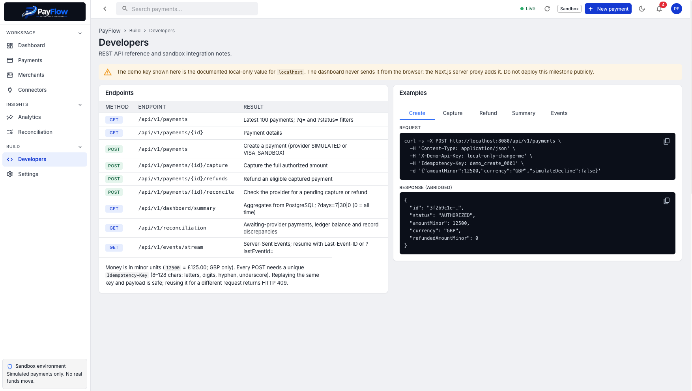

## Overview

PayFlow is a payment acceptance and operations platform: a Spring Boot REST API, a PostgreSQL-backed double-entry-style financial journal, and a responsive Next.js merchant dashboard. It covers payment authorization, capture, partial and full refunds, merchant profiles, payment providers, transaction analytics, reconciliation, and database-backed idempotency.

**This is a local development and sandbox project.** Payments, providers and ledger amounts are simulated. It is not production-ready, has not been certified for live payments, does not process real money, and is not affiliated with Visa or any card network. See [SECURITY.md](SECURITY.md).
=======
  
</p>

# PayFlow Acceptance Solution

> A payment acceptance operations dashboard for monitoring transactions, managing merchants, and exploring a payments REST API. **Local sandbox with simulated payments. No real money moves.**


## Overview

| | |
|---|---|
| **Product** | PayFlow Acceptance Solution |
| **Package** | `payflow-dashboard` |
| **Version** | `1.0.0` |
| **Category** | Fintech / Payment Acceptance |
| **Environment** | Local sandbox, simulated payments |

This repository contains the PayFlow dashboard: a Next.js application that gives operators a live view of payment activity (authorizations, captures, declines and refunds), merchant profiles, provider health, analytics and reconciliation. It talks to a PayFlow REST API (PostgreSQL-backed) through a server-side proxy, so provider and API credentials never reach the browser.

> **Status:** this milestone is for local development and sandbox testing. It is not production-ready, has not been certified for live payment processing, and does not process real funds. See [SECURITY.md](SECURITY.md).
>>>>>>> 66acd5f (Commit)

## Technology stack

| Layer | Technology |
|---|---|
| Frontend | Next.js 16, React 19, TypeScript, Material UI, TanStack Query, Recharts |
| Backend | Java 21, Spring Boot 4.1.2, Spring Security, REST API, Server-Sent Events |
| Database | PostgreSQL with Flyway migrations |
| Providers | Built-in simulator; optional Visa Acceptance sandbox |
| Tooling | Docker Compose, Maven, Vitest, Testcontainers, Jenkins, GitHub Actions, Prometheus/Grafana/OpenTelemetry (optional) |

## Dashboard features

- **Payments:** transaction list with search, status and date-range filters, CSV export, inline capture and refund, and a details panel.
- **Authorization, capture, refund:** simulated authorizations and declines, full capture, partial and full refunds.
- **Merchants:** merchant accounts, transaction statistics (captured volume, success rate, decline rate), editable merchant profile.
- **Providers and connectors:** simulator and Visa Acceptance sandbox provider selection and health.
- **Analytics:** daily series, gross and net volume, status breakdown.
- **Reconciliation:** payments awaiting the provider, ledger balance, record discrepancies.
- **Developers:** REST endpoint reference with copyable request and response examples.
- **Live updates and notifications:** SSE-driven live status, notification centre, light/dark theme.
- **Sandbox:** clear sandbox labelling throughout; no real funds move.

## Application screenshots

### Payments dashboard

=======
| Frontend | Next.js 16 (App Router), React 19, TypeScript |
| UI | Material UI, Emotion, Recharts, Motion |
| Data fetching | TanStack Query, Server-Sent Events for live updates |
| Backend (separate service) | REST API at `/api/v1/*` |
| Database | PostgreSQL (owned by the backend) |
| Testing | Vitest, Testing Library, jsdom, V8 coverage |
| Tooling | ESLint, TypeScript, Docker |

## Dashboard features

- **Payments** — searchable, filterable transaction table (status, 7/30-day windows), payment detail panel, create payment, capture, refund, CSV export.
- **Merchants** — merchant accounts with transaction counts, captured volume, success rate and last activity; editable merchant profile; recent transactions per merchant.
- **Connectors** — payment providers with health derived from provider operations.
- **Analytics** — payment volume, success vs. decline, refund trend, transactions by status and activity by hour.
- **Reconciliation** — payments awaiting the provider or review, and record discrepancies.
- **Developers** — REST endpoint reference with copyable request/response examples (create, capture, refund, summary, events).
- **Notifications** — notification center and toasts, with a live connection indicator.
- **Settings** — appearance (light/dark) and sidebar preferences, stored in the browser only.
- **Sandbox mode** — every payment is simulated; the UI shows a persistent *Sandbox environment* notice.

## Application screenshots

### Payments Dashboard
>>>>>>> 66acd5f (Commit)
Monitor transactions, payment statuses, authorizations, captures, and refunds.


<<<<<<< HEAD
### Developer API integration

=======
### Developer API Integration
>>>>>>> 66acd5f (Commit)
Explore REST API endpoints, integration examples, requests, and responses.



<<<<<<< HEAD
### Merchant management

=======
### Merchant Management
>>>>>>> 66acd5f (Commit)
Manage merchant accounts, payment activity, transaction statistics, and merchant profiles.


<<<<<<< HEAD
## Quick start

Requirements: **Docker Desktop** (with Docker Compose) and enough RAM to run PostgreSQL, Java and Next.js.

```bash
docker compose up --build
```

Open:

- **Dashboard:** http://localhost:3000
- **Backend health:** http://localhost:8080/actuator/health

The first startup creates the PostgreSQL schema with Flyway. **No data is seeded**: the dashboard shows empty states until you create payments. (For UI development only, `PAYFLOW_SEED_DEMO_DATA=true` seeds synthetic history; volumes created by earlier versions may still contain it. `docker compose down -v` wipes the local database.) The API starts independently of the dashboard; if the dashboard briefly reports that the API is unavailable, press **Refresh** once the backend is ready.

Stop the stack with `Ctrl+C` or `docker compose down`. To **delete your local demo data**, run `docker compose down -v` (irreversible for the local volume).

### What to try in the UI

1. Go to **Overview** and see real API-backed transaction counts, daily chart, gross captured volume, net processed volume, and decline rate.
2. Click **New payment** and enter `125.00` to create an authorized GBP payment.
3. Click the **eye** icon for that payment and **Capture full amount**.
4. Open the same payment and issue a `25.00` refund. Confirm the status becomes `PARTIALLY_REFUNDED`.
5. Search/filter transactions and click **Export** to download a CSV.
6. Tick **Simulate a declined authorization** when creating a payment to see the declined path.

Sections that say **Soon** are upcoming milestones, not functional features.

## Real-time architecture

```text
Browser (Next.js, TanStack Query) ──/api proxy──▶ Spring Boot ──▶ Visa Acceptance sandbox
        ▲                                             │
        │ SSE (/api/events/stream)                    ▼
        └──────────── after-commit fan-out ◀── PostgreSQL: payments, ledger, visa_operations,
                                                          domain_events (outbox), audit_log
```

- PostgreSQL is the source of truth. Every payment status change writes a `domain_events` row **in the same transaction**; the SSE push happens only **after commit**, so a rollback emits nothing.
- Event IDs are stable (`evt_<seq>`). Clients resume with `Last-Event-ID` / `?lastEventId=`; if the gap is too large or the cursor is unknown the server sends `resync` and the client refetches everything.
- The browser never talks to Visa and never sees credentials. The Next.js server adds the demo key (including for the streaming proxy at `app/api/events/stream`).
- The header shows **Live** (green) only once the stream's `ready` frame arrives. Otherwise it shows Connecting, Reconnecting (polling every 15 s) or Offline. Reconnects use exponential backoff with jitter and trigger a full refresh.
- No optimistic updates: a payment's status in the UI is only ever what the backend has committed.
- Pending captures/refunds are resolved by a backend reconciler (read-only status lookups every 30 s; `PAYFLOW_RECONCILER_ENABLED`). Unknown outcomes (`REVIEW_REQUIRED`) are never retried automatically. Provider outcomes and recovery actions are recorded in `audit_log`.
- Financial POSTs to Visa are never retried. Read-only status lookups retry transient failures twice. A Visa 4xx (except 408/429) is treated as a definitive rejection; timeouts, 429 and 5xx leave the outcome unknown.

## API examples

The API is authenticated with **per-merchant API keys** enforced by Spring Security. Keys are stored only as SHA-256 digests in `api_keys`, and every query, idempotency key, ledger/audit row, dashboard aggregate and SSE stream is scoped to the key's merchant. Browsers never hold a key: the Next.js server proxies requests and adds it. Send a key as `X-Api-Key`, `Authorization: Bearer <key>`, or the legacy `X-Demo-Api-Key`. For direct local calls:

```bash
curl -s http://localhost:8080/api/v1/dashboard/summary \
  -H 'X-Demo-Api-Key: local-only-change-me'

=======
## Payment processing architecture

```text
Browser (Next.js + TanStack Query)
   │  /api/* (no credentials in the browser)
   ▼
Next.js server proxy  ── adds API key server-side ──▶  PayFlow REST API  ──▶  PostgreSQL
   ▲                                                         │
   └──────────── Server-Sent Events (/api/v1/events/stream) ◀┘
```

- The browser only calls the Next.js proxy (`app/api/[...path]/route.ts`). The proxy attaches the API key from a server-side environment variable.
- Payment status shown in the UI is whatever the backend has committed; there are no optimistic updates.
- Live updates arrive over Server-Sent Events. The header shows **Live** only after the stream is ready; otherwise the dashboard falls back to reconnecting and polling.
- Money is handled in **minor units** (`12500` = £125.00). The sandbox supports GBP only.
- Every `POST` carries an `Idempotency-Key`, so retries do not create duplicate payments, captures or refunds.

## REST API

These are the endpoints documented in the in-app **Developers** page. Base path: `/api/v1`.

| Method | Endpoint | Result |
|---|---|---|
| GET | `/api/v1/payments` | Latest 100 payments; `?q=` and `?status=` filters |
| GET | `/api/v1/payments/{id}` | Payment details |
| POST | `/api/v1/payments` | Create a payment (provider `SIMULATED` or `VISA_SANDBOX`) |
| POST | `/api/v1/payments/{id}/capture` | Capture the full authorized amount |
| POST | `/api/v1/payments/{id}/refunds` | Refund an eligible captured payment |
| POST | `/api/v1/payments/{id}/reconcile` | Check the provider for a pending capture or refund |
| GET | `/api/v1/dashboard/summary` | Aggregates from PostgreSQL; `?days=7\|30\|0` (0 = all time) |
| GET | `/api/v1/reconciliation` | Awaiting-provider payments, ledger balance, record discrepancies |
| GET | `/api/v1/events/stream` | Server-Sent Events; resume with `Last-Event-ID` or `?lastEventId=` |

Every `POST` needs a unique `Idempotency-Key` (8–128 characters: letters, digits, hyphen, underscore). Replaying the same key and payload is safe; reusing the key for a different request returns HTTP `409`.

**Example — create a payment (local sandbox):**

```bash
>>>>>>> 66acd5f (Commit)
curl -s -X POST http://localhost:8080/api/v1/payments \
  -H 'Content-Type: application/json' \
  -H 'X-Demo-Api-Key: local-only-change-me' \
  -H 'Idempotency-Key: demo_create_0001' \
  -d '{"amountMinor":12500,"currency":"GBP","simulateDecline":false}'
```

<<<<<<< HEAD
Copy the returned `id`, then:

```bash
curl -s -X POST http://localhost:8080/api/v1/payments/<PAYMENT_UUID>/capture \
  -H 'X-Demo-Api-Key: local-only-change-me' \
  -H 'Idempotency-Key: demo_capture_0001'

curl -s -X POST http://localhost:8080/api/v1/payments/<PAYMENT_UUID>/refunds \
  -H 'Content-Type: application/json' \
  -H 'X-Demo-Api-Key: local-only-change-me' \
  -H 'Idempotency-Key: demo_refund_0001' \
  -d '{"amountMinor":2500}'
```

**Endpoints**

| Method | Endpoint | Result |
|---|---|---|
| GET | `/api/v1/payments` | Most recent 100 payments; `?q=` and `?status=` filters |
| GET | `/api/v1/payments/{id}` | Payment details |
| POST | `/api/v1/payments` | Create simulated authorization or decline |
| POST | `/api/v1/payments/{id}/capture` | Capture full authorized amount |
| POST | `/api/v1/payments/{id}/refunds` | Refund an eligible captured payment |
| POST | `/api/v1/payments/{id}/reconcile` | Look up a pending capture/refund at the provider |
| GET | `/api/v1/dashboard/summary?days=7\|30\|0` | Aggregates from PostgreSQL for the window (0 = all time), previous window, daily series, status counts, provider health |
| GET | `/api/v1/reconciliation` | Payments awaiting the provider/review, ledger balance, record discrepancies |
| GET | `/api/v1/merchants` | The authenticated merchant's profile (a list of one) |
| PATCH | `/api/v1/merchants/{merchantId}` | Partial update of `displayName`, `contactEmail`, `businessName`; `""` clears an optional field. Own merchant only (others: `404`). Emits `MERCHANT_UPDATED` on the event stream |
| GET | `/api/v1/events/stream` | Server-Sent Events (`ready`, `heartbeat`, `PAYMENT_STATUS_CHANGED`, `resync`) |

Money is represented in **minor units**: `12500` means **£125.00**. For now the demo supports GBP only.

All POST endpoints require a new `Idempotency-Key` for each logically distinct request (8–128 characters using letters, digits, hyphen or underscore). Reusing the same key and payload avoids duplicate side effects; reusing that key for a different request returns HTTP 409.

### Verify the flow automatically

With `docker compose up --build` still running:

```bash
python3 scripts_smoke_test.py
```

Expected output: `PASS: create, retry, capture, partial refund, read`.

### Inspect the ledger

```bash
docker compose exec postgres psql -U payflow -d payflow \
  -c "SELECT journal_id, operation, account_code, direction, amount_minor FROM ledger_entries ORDER BY created_at DESC LIMIT 16;"
```

To verify that every journal is balanced:

```sql
SELECT journal_id,
  SUM(CASE WHEN direction='DEBIT' THEN amount_minor ELSE -amount_minor END) AS imbalance_minor
FROM ledger_entries
GROUP BY journal_id
HAVING SUM(CASE WHEN direction='DEBIT' THEN amount_minor ELSE -amount_minor END) <> 0;
```

This should return **zero rows**.

### Merchants and API keys

`PAYFLOW_DEMO_API_KEY` registers the key for `demo_merchant`. To add more merchants set `PAYFLOW_BOOTSTRAP_KEYS="merchant_b=<key>,merchant_c=<key>"` (keys must be at least 16 characters; use long random values outside local development). Keys that are no longer configured are revoked at the next startup, so rotating the variable invalidates the old key. To revoke one immediately: `UPDATE api_keys SET revoked_at = now() WHERE merchant_id = '...'`. Missing or invalid keys get `401`; another merchant's payment ids return `404`. This is still key-based machine authentication, not user login/RBAC (OAuth2/OIDC would be the next step).

### Observability (optional)

```bash
docker compose --profile observability up -d --build
```

- Prometheus: http://127.0.0.1:9090 (scrapes `/actuator/prometheus`)
- Grafana: http://127.0.0.1:3001 (admin / `GRAFANA_ADMIN_PASSWORD`, default `payflow-local`), with a provisioned **PayFlow operations** dashboard (request rate, p95 latency, SSE subscribers/events, JVM heap, DB pool)
- OpenTelemetry traces: set `PAYFLOW_OTLP_ENABLED=true` to export OTLP traces to the bundled collector, which prints span summaries (`docker compose logs otel-collector`). Sampling: `PAYFLOW_TRACE_SAMPLING` (default 1.0).

## Local testing guide (macOS)

Prerequisites: Docker Desktop, Java 21+, Maven, Node 22.

1. **Backend tests** (Testcontainers starts PostgreSQL; Docker must be running; Visa is mocked): `cd backend && mvn test`
2. **Frontend**: `cd frontend && npm install && npm run lint && npm test && npm run build`
3. **Run the stack with the simulator only**: `PAYFLOW_VISA_ENABLED=false docker compose up -d --build`, then open **http://127.0.0.1:3000**. (Use `127.0.0.1`: another app on your Mac may own `localhost:8080`.)
4. **Watch live updates**: open the dashboard, then in a terminal run `curl -N http://127.0.0.1:8080/api/v1/events/stream -H 'X-Demo-Api-Key: local-only-change-me'` and create/capture/refund payments in the UI or with `python3 scripts_smoke_test.py`. KPIs, charts and the table update without a refresh and changed rows briefly highlight.
5. **Disconnect test**: `docker compose stop backend` — the header goes to Reconnecting/Offline and the last data stays visible with an error banner. `docker compose start backend` — it returns to Live and refetches everything.
6. **Visa sandbox (optional, separate)**: put your own sandbox credentials in `.env` (see `.env.example`), run `docker compose up -d --build`, then `python3 scripts_visa_live_smoke.py`. It makes one authorization and one capture with the documented test card. Do not load-test the sandbox.

## Continuous integration (Jenkins)

A Jenkins pipeline (`Jenkinsfile`) builds and tests the platform on a dedicated agent: backend unit tests, Testcontainers integration tests, frontend lint/tests/build, an isolated end-to-end run, secret and dependency scanning, and coverage and JUnit reports. Jenkins runs at **http://localhost:8081** (localhost only) and never touches your Docker Desktop containers: builds use an isolated Docker-in-Docker daemon. Setup, the stage-by-stage explanation and troubleshooting are in [`docs/jenkins-setup.md`](docs/jenkins-setup.md). GitHub Actions keeps running its own checks; neither system deploys.

Running the same checks by hand: `cd backend && mvn test -Dtest='!*IntegrationTest'` (unit, no Docker), `mvn test -Dtest='*IntegrationTest'` (needs Docker), `cd frontend && npm run typecheck && npm run lint:eslint && npm run test:ci && npm run build`.

## Repository layout

```text
payflow-platform/
├── backend/
│   ├── pom.xml                         # Spring Boot 4.1.2, Java 21
│   ├── src/main/java/dev/payflow/
│   │   ├── api/                        # REST endpoints + validation errors
│   │   ├── core/                       # Payment state machine, idempotency, ledger
│   │   ├── infra/                      # Local-only API key and synthetic seed data
│   │   └── model/                      # Request + response records
│   └── src/main/resources/db/migration/  # Flyway migrations
├── frontend/
│   ├── app/page.tsx                    # Interactive merchant operations UI
│   ├── app/api/[...path]/route.ts      # Next server-side backend proxy
│   └── components/                    # Icons and chart
├── docs/
│   ├── architecture.md
│   ├── jenkins-setup.md                # Jenkins CI: install, pipeline, troubleshooting
│   ├── roadmap.md
│   └── test-strategy.md
├── infrastructure/
│   ├── jenkins/                        # Jenkins controller + build agent + isolated Docker-in-Docker (compose, JCasC)
│   └── ci/                             # Pipeline helpers: report verification, e2e flow, coverage gate, scans
├── Jenkinsfile                         # Declarative CI pipeline
├── .github/workflows/checks.yml
├── docker-compose.yml
└── scripts_smoke_test.py
```

## Architecture decisions (MVP)

- **Modular monolith first:** Spring Boot owns the payment workflow, consistent database boundaries, and data access. Extract services only after defining independent transactional responsibilities.
- **Transactions:** Capture and refund update payment state and append two compensating journal entries in one database transaction. No partial financial success should be committed.
- **Idempotency:** PostgreSQL unique key plus row lock serializes duplicate requests, even from concurrent callers. Replays currently return the latest payment projection instead of an archived original response body.
- **Frontend security boundary:** The development key stays in Next.js server environment variables. There is no end-user login or real RBAC yet.
- **Not implemented:** Kafka (the transactional outbox + SSE covers current needs), Redis, OAuth2/OIDC user login and RBAC (merchant isolation exists via API keys). Prometheus, Grafana and OTel tracing are in the optional `observability` profile. A Prometheus endpoint is exposed at `/actuator/prometheus` (includes `payflow_sse_subscribers`, `payflow_sse_events_sent_total`). SSE fan-out is in-process: running several backend instances would need Postgres LISTEN/NOTIFY or a broker. See `docs/roadmap.md`.

See [Architecture](docs/architecture.md), [Roadmap](docs/roadmap.md) and [Test strategy](docs/test-strategy.md).

## Local development without Docker builds

If you have Maven 3.9+, Java 21, Node.js 22, npm and a local PostgreSQL database:

1. Start a PostgreSQL database called `payflow` with user `payflow` and password `payflow_local` (or override the variables in `backend/src/main/resources/application.yml`).
2. In `backend/`, run `SPRING_PROFILES_ACTIVE=demo mvn spring-boot:run`.
3. In `frontend/`, run `npm install && npm run dev`.
4. Open http://localhost:3000.

Run backend tests with `cd backend && mvn test`; run frontend type checking with `cd frontend && npm run lint`. The repository includes CI definitions, but integration/concurrency tests remain a planned milestone.

## Security warning

**Do not deploy this milestone publicly.** The well-known default demo key, API proxy without real user sessions (anyone who can reach the dashboard acts as the demo merchant), development database password, and seed data are intentionally for **localhost only**. Implement user login with OAuth2/OIDC, RBAC, secret management, CSRF/origin and rate-limit defenses, audit logging, and an external threat review before any public demo. Never store actual card details, PAN or CVV.

## Interview discussion prompts

- What happens if two requests with the same idempotency key arrive concurrently?
- How do you guarantee balanced ledger entries if a refund fails halfway through?
- Why is a modular monolith appropriate before introducing Kafka?
- How would you add a provider callback and an outbox to avoid lost events?
- How would you change access control for a multi-merchant, public deployment?

## Environment variables and configuration

Copy `.env.example` to `.env` and set values locally. `.env` files are git-ignored; only `.env.example` is tracked. Provider credentials stay in server-side environment variables and are never sent to the browser. See `.env.example` for the full list (for example `PAYFLOW_DEMO_API_KEY`, `PAYFLOW_BOOTSTRAP_KEYS`, `PAYFLOW_VISA_ENABLED`).

## Security

See [SECURITY.md](SECURITY.md) for the security policy, vulnerability reporting, and sandbox limitations.

## Copyright and licensing

Copyright © 2026 PayFlow. All rights reserved. This software is proprietary and unlicensed for use, copying, modification or distribution without written permission. See [LICENSE.md](LICENSE.md) and [COPYRIGHT](COPYRIGHT). "PayFlow" is a placeholder copyright holder until ownership details are confirmed. Visa and other trademarks belong to their respective owners; this project is unaffiliated with them.
=======
`local-only-change-me` is a documented placeholder for local sandbox use only. Never use it, or any default key, outside localhost.

## Local development setup

**Requirements:** Node.js 22+, npm, and a running PayFlow REST API (default `http://localhost:8080`). Docker is optional.

```bash
git clone https://github.com/domwokorach/PayFlow-Acceptance-Solution.git
cd PayFlow-Acceptance-Solution
npm install
cp .env.example .env      # then edit values for your sandbox
npm run dev               # http://localhost:3000
```

Production build and container:

```bash
npm run build
npm run start
docker build -t payflow-dashboard .
```

| Script | Purpose |
|---|---|
| `npm run dev` | Start the dev server |
| `npm run build` / `npm run start` | Build and serve the app |
| `npm run lint` | Type check, then ESLint |
| `npm run typecheck` | `tsc --noEmit` |
| `npm test` | Run the Vitest suite |
| `npm run test:coverage` | Tests with coverage |
| `npm run test:ci` | Coverage plus a JUnit report in `reports/` |

## Environment variables and configuration

Keep real values in a local `.env`, which is excluded from Git. Only `.env.example` is committed.

| Variable | Used by | Purpose |
|---|---|---|
| `PAYFLOW_API_ORIGIN` | Dashboard server proxy | Backend origin (default `http://localhost:8080`) |
| `PAYFLOW_DEMO_API_KEY` | Dashboard server proxy | Local sandbox API key sent as `X-Demo-Api-Key` (server-side only) |
| `PAYFLOW_VISA_ENABLED` | Backend | Enable the optional Visa sandbox provider (`false` = simulator only) |
| `PAYFLOW_VISA_MERCHANT_ID`, `PAYFLOW_VISA_KEY_ID`, `PAYFLOW_VISA_SHARED_SECRET` | Backend | Sandbox provider credentials (never expose to the browser) |
| `PAYFLOW_SEED_DEMO_DATA` | Backend | Synthetic history for UI development only |

## Testing and security

```bash
npm run typecheck && npm run lint:eslint && npm run test:ci && npm run build
```

The suite covers notification logic and UI, live-event handling, merchants, payment UI flows, count-up animation, colour contrast and hydration.

Security summary (details in [SECURITY.md](SECURITY.md)):

- API keys and provider credentials stay in server-side environment variables, never in browser JavaScript or Git.
- Capture and refund calls are idempotent and validated by the backend.
- This milestone has no end-user login or role-based access control; **do not deploy it publicly**.

## Project structure

```text
.
├── app/                 # Next.js routes: payments, merchants, connectors,
│                        #   analytics, reconciliation, developers, settings
│   └── api/             # Server-side proxy and event-stream route
├── components/          # Shell, payments, merchants, notifications, charts, UI kit
├── hooks/               # React hooks
├── lib/                 # API client, live updates, analytics, theme, types
├── public/              # Static assets (logo)
├── tests/               # Vitest tests
├── docs/
│   ├── images/          # README screenshots
│   └── logo-readme.png  # README logo
├── COPYRIGHT
├── LICENSE.md
├── SECURITY.md
├── Dockerfile
└── package.json
```

## Copyright and licensing

Copyright © 2026 PayFlow. All rights reserved. This is proprietary software, licensed under no open-source licence (`UNLICENSED` in `package.json`). See [COPYRIGHT](COPYRIGHT) and [LICENSE.md](LICENSE.md). PayFlow is a sample application and is not affiliated with Visa or any payment network.
>>>>>>> 66acd5f (Commit)
