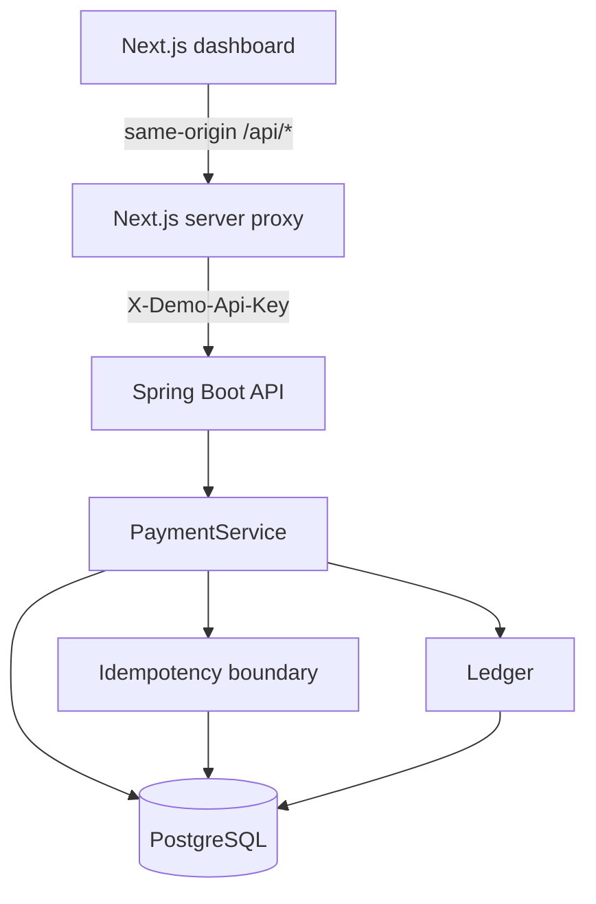
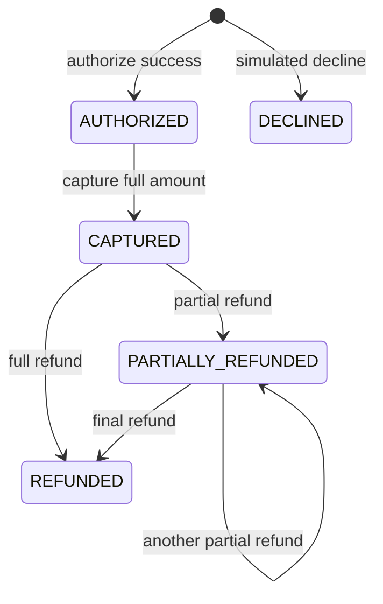

# PayFlow architecture — first milestone

## Scope

**Simulated card-processing workflow, not a payment gateway.** All payments use fictitious provider `SIMULATED`, and the system does not handle real PAN, CVV, or network settlement.

- Frontend runs on port 3000, backend on 8080, PostgreSQL on 5432; all bound to loopback on the developer machine.
- Business state transitions and accounting entries execute in **one PostgreSQL transaction**.
- Duplicate mutations use `Idempotency-Key`; the key is unique per merchant and locked with `SELECT ... FOR UPDATE`.
- Different request bodies cannot reuse a key, as the request fingerprint is stored and compared.
- For a **successful repeated request**, no new business operation occurs. The replay returns the current payment projection (or original refund record); this is a documented MVP trade-off, not exact HTTP response caching.
- A ledger journal contains one debit and one credit of equal size. Capture posts DEBIT merchant clearing, CREDIT merchant payable; refund reverses those entries.
- Demo data initializes only when the `demo` profile is enabled and the database is empty.
- The **single demo merchant** intentionally simplifies tenant scoping. OAuth2, full multi-tenant isolation, KMS and roles belong in later milestones.

## Payment lifecycle

## Constraints

- Amount is signed 64-bit integer minor units (GBP pence in demo), never floating point in backend persistence.
- No partial captures, multiple currencies per merchant, pending asynchronous provider states, or external card APIs in milestone 1.
- Ledger entry pair correctness is provided by the service's single SQL insert and transaction, not yet enforced by a deferred database invariant.
- There is no Kafka, Redis, Spring Security/OAuth2, or AWS integration in this initial milestone; those are documented next steps, not implemented claims.
- Demo shared key provides a development gate only; **do not expose to the public internet**.
